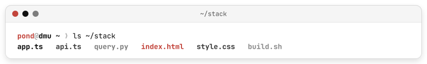

<!--
  这些图都是 scripts/generate.py 画出来的。
  改文字：编辑 config.toml 并提交，Actions 会在一分钟内重画。
  数据卡片（neofetch、热力图）每天自动更新一次。
-->

<picture>
  <source media="(prefers-color-scheme: dark)" srcset="https://raw.githubusercontent.com/Pond-official/Pond-official/main/assets/header-dark.svg">
  
</picture>

  <a href="https://github.com/Pond-official/EDaYi"><picture>
    <source media="(prefers-color-scheme: dark)" srcset="https://raw.githubusercontent.com/Pond-official/Pond-official/main/assets/badge-edayi-dark.svg">
    
  </picture></a>&nbsp;
  <a href="https://pond-official.github.io/e-dayi-agreement/"><picture>
    <source media="(prefers-color-scheme: dark)" srcset="https://raw.githubusercontent.com/Pond-official/Pond-official/main/assets/badge-agreement-dark.svg">
    
  </picture></a>&nbsp;
  <a href="https://www.dmu.edu.cn/"><picture>
    <source media="(prefers-color-scheme: dark)" srcset="https://raw.githubusercontent.com/Pond-official/Pond-official/main/assets/badge-dmu-dark.svg">
    
  </picture></a>

<picture>
  <source media="(prefers-color-scheme: dark)" srcset="https://raw.githubusercontent.com/Pond-official/Pond-official/main/profile/neofetch-dark.svg">
  
</picture>

<picture>
  <source media="(prefers-color-scheme: dark)" srcset="https://raw.githubusercontent.com/Pond-official/Pond-official/main/assets/stack-dark.svg">
  
</picture>

<picture>
  <source media="(prefers-color-scheme: dark)" srcset="https://raw.githubusercontent.com/Pond-official/Pond-official/main/profile/activity-dark.svg">
  
</picture>

<picture>
  <source media="(prefers-color-scheme: dark)" srcset="https://raw.githubusercontent.com/Pond-official/Pond-official/main/assets/footer-dark.svg">
  
</picture>

